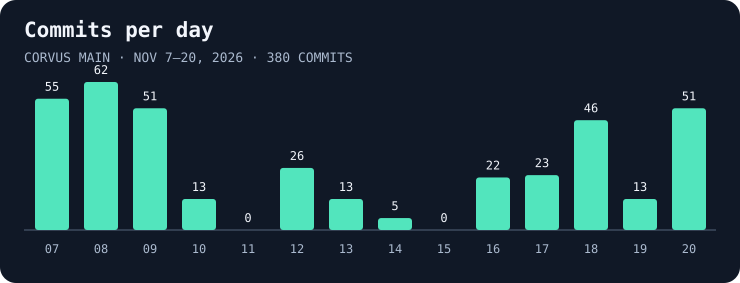
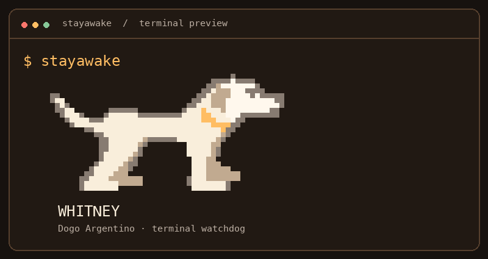
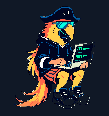

<a href="https://corvus.gent/logo">
  <picture>
    <source media="(prefers-color-scheme: dark)" srcset="assets/corvus-flight-dark.gif">
    <source media="(prefers-color-scheme: light)" srcset="assets/corvus-flight-light.gif">
    
  </picture>
</a>

<h1>I'm Gabriel 👋</h1>

Crazy Belgian Latino who speaks 7 languages and a few programming languages. I haven’t spoken the programming ones in a while. I only prompt engineer rn.

My stack is <a href="https://claude.ai/">Claude</a>, <a href="https://openai.com/codex/">Codex</a> and <a href="https://grok.com/">Grok</a>.

[Corvus](https://corvus.gent) · [LinkedIn](https://www.linkedin.com/in/francisco-gabriel-van-langenhove) · [X](https://x.com/gabe_maxxing)

## Contribute to my open-source projects

- **NEW:** [Corvus Noctis](https://github.com/gabe-maxxing/corvus-noctis) is an operating system you can talk to. It's built from scratch in Rust in the spirit of TempleOS. [Try it in your browser](https://gabe-maxxing.github.io/corvus-noctis/), even on your phone.
- [stayawake](https://github.com/gabe-maxxing/stayawake) keeps your Mac awake during long jobs.
- **SINK LUMA:** [The Hackers Bay](https://github.com/Corvus-gent/the-hackers-bay) lets pirates RSVP to people and build their own parrot.
- [nightjar-mcp](https://github.com/gabe-maxxing/nightjar-mcp) is a small MCP server you can host yourself.
- [FlowSOM](https://github.com/gabe-maxxing/FlowSOM) benchmarks clustering for flow cytometry with Python and Numba.

---

## Here's some cool stats about my coding obsession

**380 commits in 14 days** on Corvus’s main branch, including contributors. Dates are in Brussels time.

[More Corvus build stats](https://corvus.gent/built#shipping)

---

## Here are a few cool characters from projects I made

| Whitney | Captain Squawk |
| :---: | :---: |
|  |  |
| The [stayawake](https://github.com/gabe-maxxing/stayawake) watchdog. | The [Hackers Bay](https://corvus.gent/hackersbay) parrot. |
