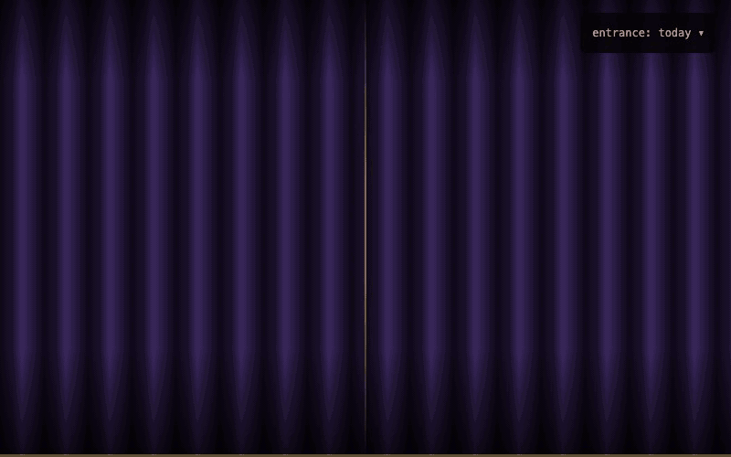
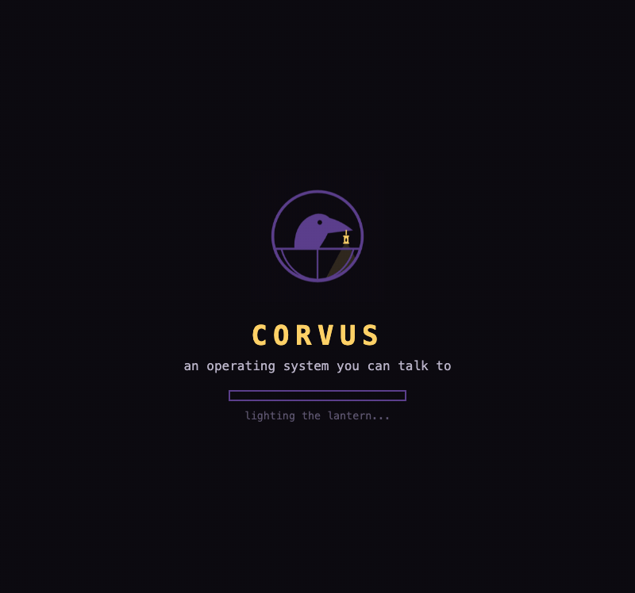
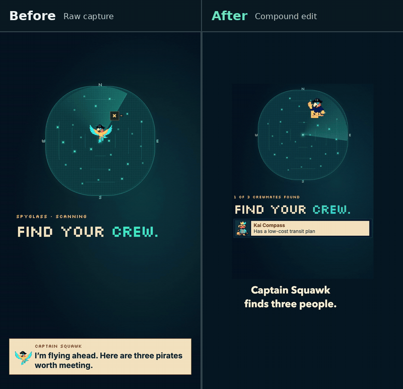

  <a href="https://corvus.gent">
    <picture>
      <source media="(prefers-color-scheme: dark)" srcset="stats/gabe-dark.svg">
      
    </picture>
  </a>

building things on a refurbished M1. <a href="https://corvus.gent">corvus.gent</a>

  <picture>
    <source media="(prefers-color-scheme: dark)" srcset="stats/lines-shipped-dark.svg">
    
  </picture>
  <picture>
    <source media="(prefers-color-scheme: dark)" srcset="stats/summary-dark.svg">
    
  </picture>

<b>more</b>

 

  <picture>
    <source media="(prefers-color-scheme: dark)" srcset="stats/heatmap-dark.svg">
    
  </picture>
  <picture>
    <source media="(prefers-color-scheme: dark)" srcset="stats/stack-dark.svg">
    
  </picture>
  <picture>
    <source media="(prefers-color-scheme: dark)" srcset="stats/streak-dark.svg">
    
  </picture>
  <picture>
    <source media="(prefers-color-scheme: dark)" srcset="stats/agents-dark.svg">
    
  </picture>

Lines are additions + deletions I authored, private repos included and never named. Lockfiles, vendored, generated, minified and binary files and huge data dumps are left out. Raw numbers: <a href="stats/stats.json">stats.json</a>.

<a href="https://corvus.gent/build">full stats → corvus.gent/build</a>

---

| | |
| :---: | :---: |
|  |  |
| [corvus.gent](https://corvus.gent) — the realm. | [The Cube](https://corvus.gent/the6cube) — a cube you can solve in C. |
|  |  |
| [Raygifts](https://corvus.gent/raygifts) — wrap it, hack it. | [Corvus Noctis](https://github.com/gabe-maxxing/corvus-noctis) — an OS you can talk to. |
|  |  |
| The agent pipeline. | [Captain Squawk](https://corvus.gent/hackersbay) — the Hackers Bay parrot. |

## Contribute

- [Corvus Noctis](https://github.com/gabe-maxxing/corvus-noctis): an operating system you can talk to, in Rust. [Try it](https://gabe-maxxing.github.io/corvus-noctis/).
- [stayawake](https://github.com/gabe-maxxing/stayawake): keeps your Mac awake during long jobs.
- [The Hackers Bay](https://github.com/Corvus-gent/the-hackers-bay): pirates RSVP to people and build a parrot.
- [nightjar-mcp](https://github.com/gabe-maxxing/nightjar-mcp): a small MCP server you can host yourself.
- [FlowSOM](https://github.com/gabe-maxxing/FlowSOM): clustering benchmarks for flow cytometry.

ΓΝΩΘΙ ΣΑΥΤΟΝ · <a href="https://x.com/gabe_maxxing">X</a> · <a href="https://www.linkedin.com/in/francisco-gabriel-van-langenhove">LinkedIn</a>

